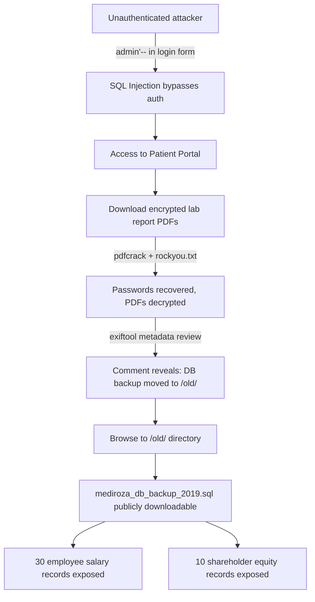

# 🛡️ Mediroza General Hospital — Penetration Testing Report


> **Full Black-Box Web Application Security Assessment**
> **Target Domain:** `https://medirozahospital.com`
> **Engagement Window:** 24–26 September 2026 (3-Day Assessment)
> **Overall Risk Rating:** 🔴 **CRITICAL** (Immediate Remediation Required)

This repository documents an authorized black-box penetration test performed against a target that simulates a hospital's public-facing web infrastructure. The assessment demonstrates a realistic, chained attack path — from an unauthenticated SQL injection foothold through to exposure of an internal database backup — and provides a full remediation roadmap.

---

## 📋 Table of Contents

- [1. Project Overview](#1-project-overview)
- [2. Executive Summary](#2-executive-summary)
  - [2.1 Summary of Assessment Findings](#21-summary-of-assessment-findings)
  - [2.2 Attack Chain at a Glance](#22-attack-chain-at-a-glance)
- [3. Scope & Methodology](#3-scope--methodology)
  - [3.1 Rules of Engagement & Constraints](#31-rules-of-engagement--constraints)
  - [3.2 Testing Phases](#32-testing-phases)
  - [3.3 Tools & Techniques](#33-tools--techniques)
- [4. Technical Findings & Proof of Exploitation](#4-technical-findings--proof-of-exploitation)
  - [4.1 Milestone 1: SQL Injection Authentication Bypass](#41-milestone-1-sql-injection-authentication-bypass-initial-access)
  - [4.2 Milestone 2: PDF Password Recovery & Decryption](#42-milestone-2-pdf-password-recovery--decryption)
  - [4.3 Milestone 3: Metadata Analysis & Unrestricted Server Data Leak](#43-milestone-3-metadata-analysis--unrestricted-server-data-leak)
- [5. Risk Assessment & Severity Rating](#5-risk-assessment--severity-rating)
- [6. Business Impact Analysis](#6-business-impact-analysis)
- [7. Actionable Recommendations & Remediation Plan](#7-actionable-recommendations--remediation-plan)
  - [7.1 Remediation Roadmap & Priority Timeline](#71-remediation-roadmap--priority-timeline)
- [8. Lessons Learned](#8-lessons-learned)
- [9. Repository Structure](#9-repository-structure)
- [10. Glossary](#10-glossary)
- [⚠️ Liability Disclaimer](#️-liability-disclaimer)
- [👤 Author & Project Information](#-author--project-information)

---

## 1. Project Overview

This engagement simulates a real-world external penetration test against a hospital web application, covering the full assessment lifecycle: reconnaissance, vulnerability discovery, exploitation, post-exploitation data handling, and professional reporting.

The target environment exposes a patient-facing login portal, a staff-facing area, and legacy infrastructure left over from a prior site migration — a combination commonly seen in real organizations where old systems are decommissioned informally rather than through a controlled process.

**Key takeaway for readers:** this report is as much about *process discipline* (scoping, authorization, evidence handling, responsible reporting) as it is about the individual vulnerabilities found.

---

## 2. Executive Summary

A full black-box web application penetration test was conducted against **Mediroza General Hospital** (`https://medirozahospital.com`). The objective of this engagement was to evaluate the overall security posture of the hospital's web infrastructure, identify exploitable vulnerabilities, and demonstrate potential real-world impact on confidential patient health information (PHI) and corporate financial records.

The assessment uncovered a severe, chained path of vulnerability exploitation:

1. An **authentication bypass via SQL injection** allowed unauthenticated remote access to the internal Patient Portal, granting access to confidential patient laboratory reports.
2. Metadata inspection of decrypted documents revealed references to an exposed server directory (`/old/`).
3. The exposed directory contained a full SQL database backup (`mediroza_db_backup_2019.sql`), which directly exposed **30 employee salary records** and **10 shareholder equity structures**.

This is a textbook example of how a single low-effort, high-skill input validation flaw (SQLi) can cascade — through poor document hygiene and forgotten legacy infrastructure — into a full-scale breach of both patient and corporate confidentiality.

### 2.1 Summary of Assessment Findings

| Milestone / Area | Vulnerability Identified | Risk Level | Impact |
| :--- | :--- | :---: | :--- |
| **M1: Initial Access** | SQL Injection Authentication Bypass in Login Portal | 🔴 **CRITICAL** | Full bypass of authentication; access to restricted patient portal and lab reports. |
| **M2: Data Extraction** | Weak PDF Encryption & Predictable Passwords | 🟠 **HIGH** | Offline cracking of encrypted PDF lab reports revealing protected health information. |
| **M3: Data Exposure** | Publicly Accessible SQL Database Backup (`/old/`) | 🔴 **CRITICAL** | Direct leak of 30 staff salaries and 10 shareholder equity details. |
| **M3: Information Leak** | Sensitive Metadata Disclosed in Patient PDFs | 🟡 **MEDIUM** | Exposed internal file paths and system migration notes aiding further compromise. |

### 2.2 Attack Chain at a Glance



Each arrow above represents a point where a single control — input sanitization, access control, password policy, metadata hygiene, or directory listing — would have broken the chain.

---

## 3. Scope & Methodology

The engagement was executed under strict black-box conditions over a 3-day window. Testing was constrained strictly to the target domain in an authorized lab environment.

### 3.1 Rules of Engagement & Constraints

* **Authorized Domain Only:** Testing was confined strictly to `https://medirozahospital.com`.
* **Prohibited Actions:** Denial of Service (DoS/DDoS), social engineering of hospital staff, and destruction of production data were strictly prohibited.
* **Confidentiality Protocol:** All sensitive data extracted during testing (PHI, salaries, shareholder data) was securely logged and redacted in final reporting.
* **Engagement Window:** 24–26 September 2026, with all testing activity logged by timestamp for the final report.
* **Data Handling:** No sensitive data was exfiltrated beyond the lab environment; all proof-of-concept artifacts were stored on an encrypted testing workstation.

### 3.2 Testing Phases

| Phase | Objective | Key Activities |
| :--- | :--- | :--- |
| **1. Reconnaissance** | Map the attack surface | Passive enumeration, identifying live hosts, technology fingerprinting |
| **2. Enumeration** | Discover hidden endpoints | Directory brute-forcing (`/patient/`, `/staff/`, `/old/`), WAF detection |
| **3. Vulnerability Analysis** | Identify exploitable weaknesses | Manual input testing on login forms, parameter fuzzing |
| **4. Exploitation** | Prove impact | SQL injection authentication bypass, portal access |
| **5. Post-Exploitation** | Assess downstream exposure | PDF password cracking, metadata review, legacy directory discovery |
| **6. Reporting** | Communicate risk & fixes | Severity rating, business impact analysis, remediation plan |

### 3.3 Tools & Techniques

| Tool / Command | Purpose & Technical Context |
| :--- | :--- |
| **HexStrike / Burp Suite** | Web application proxying, endpoint mapping, and manual SQL injection testing. |
| **Gobuster & WAFW00F** | Directory brute-forcing, route discovery (`/patient/`, `/staff/`, `/old/`), and WAF fingerprinting. |
| **pdfcrack / Hash Calculator** | Extraction of `$pdf$` encryption hashes and dictionary-based password recovery. |
| **rockyou.txt Wordlist** | Dictionary attacks against weak PDF document passwords. |
| **exiftool & pdfinfo** | Extraction and inspection of metadata properties within retrieved PDF reports. |
| **Linux CLI (`grep`, `awk`, `curl`)** | Targeted parsing and structure analysis of the extracted `mediroza_db_backup_2019.sql` file. |

---

## 4. Technical Findings & Proof of Exploitation

### 4.1 Milestone 1: SQL Injection Authentication Bypass (Initial Access)

* **Vulnerability Description:** The patient login interface at `/patient/login.php` failed to sanitize user inputs before incorporating them into backend SQL query structures.
* **Exploitation Payload:** Entering `admin'--` into the username parameter with any arbitrary password resulted in execution of the following raw query:

```sql
SELECT * FROM users WHERE username = 'admin'--' AND password = '$password'
```

Because the SQL comment sequence (`-- `) truncated the password evaluation logic, the database returned a valid administrator record.

* **Root Cause:** Direct string concatenation of unsanitized user input into a SQL statement, with no use of prepared statements, input validation, or output encoding.
* **Outcome:** The application responded with an HTTP `302 Redirect` to `portal.php`. Navigating to the portal yielded three confidential pathology laboratory reports:
  * *Pathology Report — S. Dlamini*
  * *Pathology Report — P. Reddy*
  * *Pathology Report — E. Thompson*

> **CVSS v3.1 (indicative):** 9.8 Critical — `AV:N/AC:L/PR:N/UI:N/S:U/C:H/I:H/A:H`

### 4.2 Milestone 2: PDF Password Recovery & Decryption

All three retrieved laboratory reports were encrypted using Standard PDF Security (Version 1.4, 128-bit key length). Hash extraction was performed followed by a dictionary-based password attack utilizing `pdfcrack` and the `rockyou.txt` wordlist.

| File Name | Target Patient | Recovered Password | Cracking Method |
| :--- | :--- | :--- | :--- |
| `report_1.pdf` | S. Dlamini | `123456` | `pdfcrack` + `rockyou.txt` (Instant) |
| `report_2.pdf` | P. Reddy | `password` | `pdfcrack` + `rockyou.txt` (Instant) |
| `report_3.pdf` | E. Thompson | `!@#$%^&` | `pdfcrack` + `rockyou.txt` (< 5 seconds) |

> **Impact Analysis:** Enforcing low-complexity, predictable passwords on protected health records offers no practical defense against offline dictionary attacks once files are downloaded.

> **CVSS v3.1 (indicative):** 7.5 High — `AV:N/AC:L/PR:N/UI:N/S:U/C:H/I:N/A:N`

### 4.3 Milestone 3: Metadata Analysis & Unrestricted Server Data Leak

#### 4.3.1 Metadata Discovery

Following decryption, metadata inspection was performed via `exiftool`. Examination of `report_3_decrypted.pdf` revealed an embedded system comment:

```text
Comment: "DB backup moved to /old before site migration, do not delete"
```

#### 4.3.2 Database Dump Exploitation

Navigating directly to `https://medirozahospital.com/old/` exposed an unindexed, publicly browsable directory containing `mediroza_db_backup_2019.sql`. Parsing this dump revealed full schemas and records:

* **30 Employee Salary Records:** Full names, job titles, departments, national ID numbers, and monthly salary figures.
  * *Sample Records:* `Dr. Rajesh Naidoo` (ZAR 138,000) | `Sarah Botha` (ZAR 152,000) | `Dr. Johan van der Merwe` (ZAR 160,000)
* **10 Shareholder Records:** Corporate ownership details, including shareholder entity names, exact share counts, class types (Ordinary vs. Preferential), and ownership percentages.
  * *Sample Record:* `Cedar Asset Holdings Pty Ltd` — 15.0%

> **CVSS v3.1 (indicative):** 9.1 Critical — `AV:N/AC:L/PR:N/UI:N/S:U/C:H/I:N/A:N`

---

## 5. Risk Assessment & Severity Rating

| Ref ID | Vulnerability Finding | Severity | Risk Justification |
| :---: | :--- | :---: | :--- |
| **VULN-01** | SQL Injection in Login Form | 🔴 **CRITICAL** | Allows full authentication bypass and unauthorized patient data access without credentials. |
| **VULN-02** | Exposed Web Directory & SQL Dump | 🔴 **CRITICAL** | Exposes PII, internal salary structures, and shareholder capital allocations to the public web. |
| **VULN-03** | Weak PDF Password Protection | 🟠 **HIGH** | Allows trivial offline brute-forcing of sensitive patient medical documents. |
| **VULN-04** | Sensitive Metadata Exposure | 🟡 **MEDIUM** | Provides internal path disclosure and architectural details that facilitate targeted attacks. |

---

## 6. Business Impact Analysis

| Dimension | Impact |
| :--- | :--- |
| **Regulatory** | Exposure of PHI and employee PII may trigger breach-notification obligations under applicable data protection and health-privacy regulations. |
| **Financial** | Shareholder equity disclosure could affect investor confidence and expose the organization to competitive or reputational risk. |
| **Reputational** | A hospital brand depends heavily on patient trust; a confirmed PHI leak is high-visibility reputational damage. |
| **Operational** | Legacy, unmanaged infrastructure (`/old/`) indicates a gap in asset inventory and decommissioning procedures that likely extends beyond this one directory. |
| **Human** | Affected patients and staff face personal risk (identity exposure, salary disclosure) independent of any technical remediation. |

---

## 7. Actionable Recommendations & Remediation Plan

1. **Implement Parameterized Queries (Prepared Statements)**
   Replace raw string concatenation in `login.php` with parameterized SQL queries (e.g., PDO or PreparedStatements in PHP) to completely prevent SQL injection.
2. **Enforce Robust Access Controls & IDOR Checks**
   Implement strict session validation on `/patient/portal.php` and verify server-side authorization before serving any PDF download requests.
3. **Remove & Secure Legacy Database Backups**
   Immediately delete `mediroza_db_backup_2019.sql` from web-accessible directories (`/old/`). Store database backups strictly outside the public web root with encryption at rest.
4. **Disable Directory Listing & Enforce Server Rules**
   Configure web server settings (e.g., `Options -Indexes` in Apache or Nginx equivalent) to prevent public directory browsing on paths like `/old/` and `/staff/`.
5. **Upgrade PDF Document Protection Standards**
   Mandate high-entropy, cryptographically strong passwords for generated PDF reports, or transition to a secure in-portal viewer that eliminates direct PDF distribution.
6. **Sanitize Document Metadata**
   Implement automated PDF build pipelines that strip sensitive system comments, author names, and migration history prior to file distribution.
7. **Establish an Asset Inventory & Decommissioning Process**
   Maintain a living inventory of all internet-facing directories and services so that "temporary" migration artifacts like `/old/` cannot persist unmonitored for years.
8. **Introduce Periodic Re-Testing**
   Schedule recurring penetration tests (e.g., annually, or after major infrastructure changes) to catch regressions and newly introduced flaws.

### 7.1 Remediation Roadmap & Priority Timeline

| Priority | Action | Target Timeframe |
| :---: | :--- | :--- |
| **Immediate (0–48h)** | Take `/old/` offline; rotate any credentials present in the exposed backup | Within 2 days |
| **Short-Term (1–2 weeks)** | Patch SQL injection in `login.php`; disable directory listing site-wide | Within 2 weeks |
| **Medium-Term (1 month)** | Re-issue PDF reports with strong passwords; add server-side authorization checks on the patient portal | Within 1 month |
| **Long-Term (1 quarter)** | Build asset inventory process; implement automated metadata stripping; schedule recurring pentests | Within 1 quarter |

---

## 8. Lessons Learned

* **Legacy infrastructure is a persistent risk.** A directory created for a site migration years prior remained exposed and unmonitored — a reminder that decommissioning needs to be a formal process, not an afterthought.
* **Defense-in-depth matters.** No single control failure caused this breach; it was the *combination* of a login flaw, weak document passwords, careless metadata, and an exposed backup that turned one weakness into a full compromise.
* **Metadata is an underrated attack surface.** A single leftover comment field in a PDF directly led the tester to the most damaging finding of the engagement.
* **Low-complexity passwords defeat document encryption in practice.** Encryption is only as strong as the password protecting it.

---

## 9. Repository Structure

```
mediroza-pentest-report/
├── README.md                     # This report
├── evidence/                     # Redacted screenshots and PoC artifacts (not committed publicly)
├── scripts/                      # Helper scripts used during enumeration/parsing (lab use only)
└── docs/                         # Supplementary notes and methodology references
```

> Evidence and raw data referenced in this report are withheld or redacted here in line with the confidentiality protocol described in [Section 3.1](#31-rules-of-engagement--constraints).

---

## 10. Glossary

| Term | Definition |
| :--- | :--- |
| **Black-box testing** | Security testing performed with no prior knowledge of the target's internal code or architecture. |
| **SQL Injection (SQLi)** | A code injection technique that exploits unsanitized input to manipulate backend SQL queries. |
| **PHI** | Protected Health Information — patient data subject to privacy regulation. |
| **IDOR** | Insecure Direct Object Reference — an access control flaw allowing unauthorized access to resources via predictable identifiers. |
| **CVSS** | Common Vulnerability Scoring System — a standardized severity scoring framework. |
| **Directory listing** | A web server misconfiguration that allows visitors to browse the contents of a directory with no index file. |

---

## ⚠️ Liability Disclaimer

This penetration testing report and all associated activities conducted between **24th September 2026** and **26th September 2026** were performed strictly within the authorized scope on systems for which explicit written permission was secured. The materials, findings, and methodologies detailed herein are provided solely for educational, research, and authorized remediation purposes.

Any unauthorized use, reproduction, or execution of these techniques outside the permitted scope is strictly prohibited and violates applicable laws. Neither the authors, security researchers, nor Mediroza General Hospital assume any liability or responsibility for misuse or unlawful actions taken using this knowledge; all actions and consequences remain the sole responsibility of the user.

---

## 👤 Author & Project Information

* **Author:** Dato Giovanni
* **LinkedIn:** Dato Giovanni
* **Repository:** GitHub

